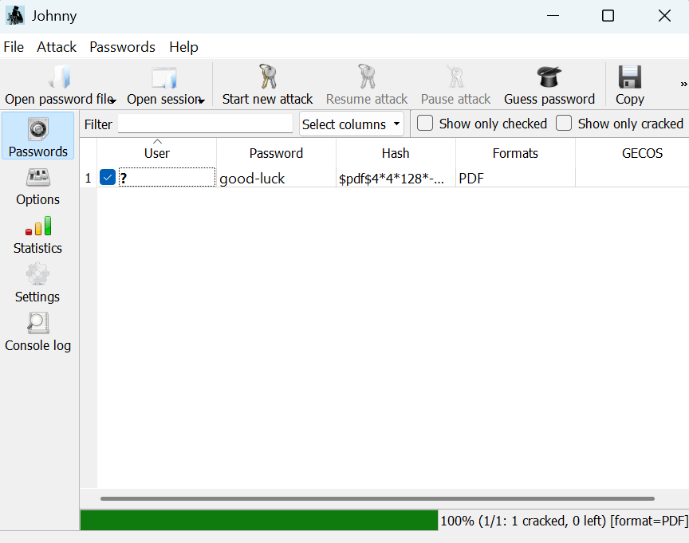
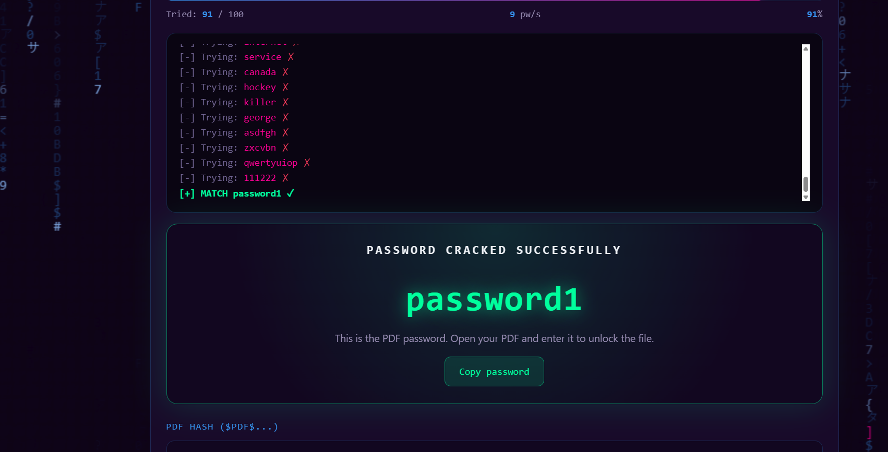

# Password-Cracking-with-JTR---NW-Tools
Password Cracking

Locked PDFs don't store their password in plain text — they store it as a hash. To recover it, you extract that hash from the file's encryption metadata, then run it through a cracking tool that tries candidate passwords until one produces a matching hash. This is standard practice in security testing for auditing password strength.

I completed the lab two ways to compare a standard offline tool against a browser-based alternative.

Method 1: John the Ripper + Johnny (GUI)

Tools: John the Ripper (jumbo build) + Johnny, its GUI front-end.

Installed JTR and Johnny on Windows, and pointed Johnny at john.exe under Settings.
Extracted the PDF's crackable hash using an online pdf2john converter, since the Windows JTR build doesn't bundle the Python extraction scripts.
Saved the hash to hash1.txt and loaded it into Johnny via Open password file.
Clicked Start new attack. Johnny handed the hash to john.exe, which ran a dictionary attack and returned a match.

Johnny GUI — password cracked, 100% (1/1 cracked)

Result: password1 — confirmed by entering it to unlock the PDF.

Method 2: Networkwalks Hash Calculator + Password Cracker (browser-only)

Tools: Networkwalks' free Hash Calculator and Password Cracker — both run entirely client-side, no install or file upload required.

Dropped the PDF into the Hash Calculator, which extracted the same $pdf$... hash locally in the browser.
Pasted the hash into the Password Cracker, selected the built-in 100-word list, and started the attack.
Watched it iterate candidates (service, canada, hockey, killer, george, asdfgh, zxcvbn, qwertyuiop, 111222...) until it hit a match.

Networkwalks Password Cracker — dictionary attack in progress, match found

Result: same password, password1 — confirmed again by unlocking the PDF.

Takeaways
Both methods converge on the same core mechanic: extract the hash → dictionary attack → match. John the Ripper is the industry-standard offline tool; the Networkwalks web tools replicate the same logic for teaching purposes.
password1 fell inside a 100-word list almost instantly — a clear illustration of why list-based, predictable passwords offer almost no real protection.
Longer, non-dictionary passphrases (and avoiding reused/common passwords) are what actually resist this class of attack.

This was run against a file built for this training exercise. Extracting and cracking hashes is only appropriate against systems/files you own or are explicitly authorized to test.
